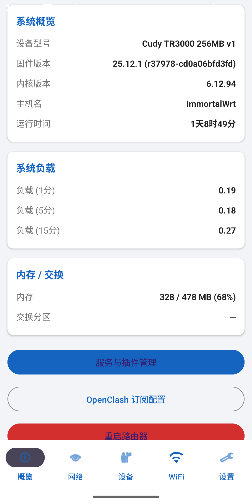
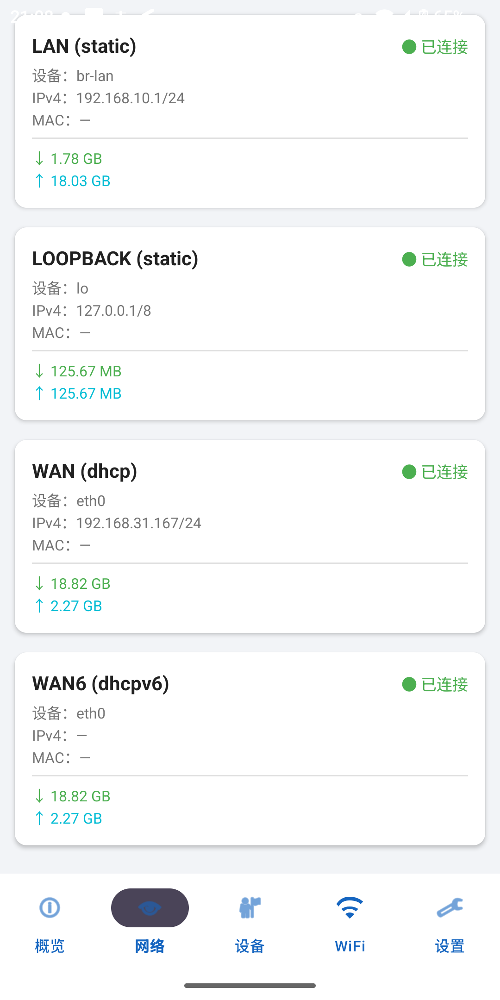
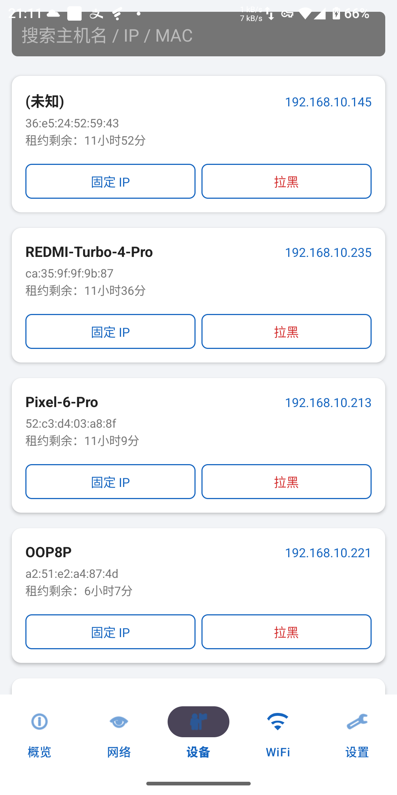
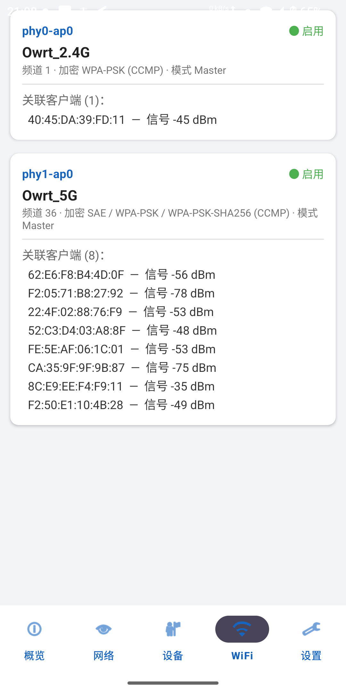
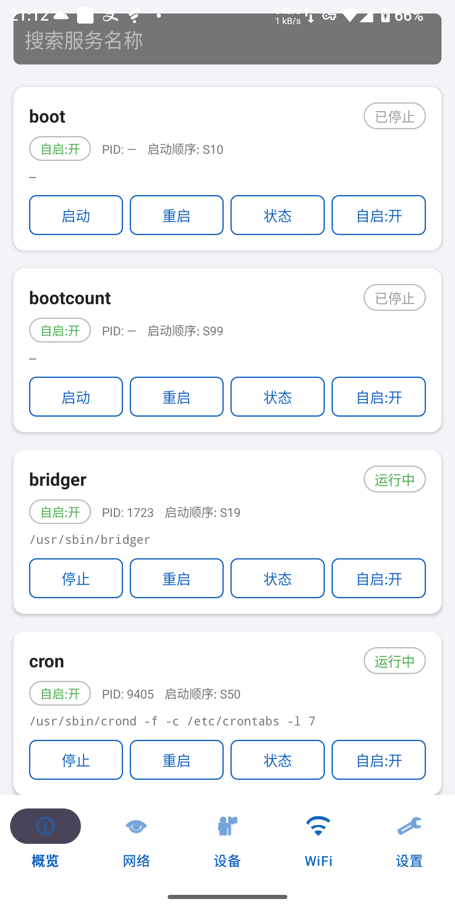

# MyOpenWrt

一个基于 ubus JSON-RPC 的 OpenWrt / ImmortalWrt 路由器管理 Android App，使用 Java + Material 3 编写。

## 功能

- **系统概览**：设备型号、固件版本、内核、运行时间、负载、内存/交换分区
- **网络接口**：接口状态、IPv4/IPv6、MAC、收发流量统计
- **已连接设备**：DHCP 租约列表，支持为设备绑定**静态 IP**、按 MAC **拉黑/解除拉黑**
- **WiFi 状态**：SSID、信道、加密方式、关联客户端与信号强度
- **服务与插件**：查看运行状态 / PID / 启动顺序，支持启动、停止、重启、状态查询、开机自启
- **OpenClash 订阅**：查看插件状态与订阅列表，支持新增、编辑、启用/禁用、删除订阅，一键更新订阅配置
- **连接设置**：路由器地址、端口、账号密码、HTTPS（信任自签名证书）

## 截图

| 系统概览 | 网络接口 | 已连接设备 |
| --- | --- | --- |
|  |  |  |

| WiFi 状态 | 服务与插件 |
| --- | --- |
|  |  |

## 技术实现

- 通过 `ubus` JSON-RPC over HTTP（`/ubus` 端点）与路由器通信，兼容新旧版本登录响应格式
- 配置读写优先使用 `ubus uci`，不支持时回退到 `uci show` 解析；写入通过 `ubus file exec` 调用 `/sbin/uci`
- 设备拉黑通过防火墙规则（源 MAC + DROP）实现，静态 IP 通过 `/etc/config/dhcp` 的静态租约实现
- 流量统计读取 `/proc/net/dev` 与接口 stats，WiFi 信息优先 `iwinfo` ubus，失败时回退命令解析

## 构建

```bash
./gradlew assembleDebug
```

生成的 APK 位于 `app/build/outputs/apk/debug/app-debug.apk`。

- minSdk 23，targetSdk 35
- Android Studio 2025.3 / JDK 17

> 连接凭据仅保存在本机 App 的 SharedPreferences 中，不包含在仓库内。
